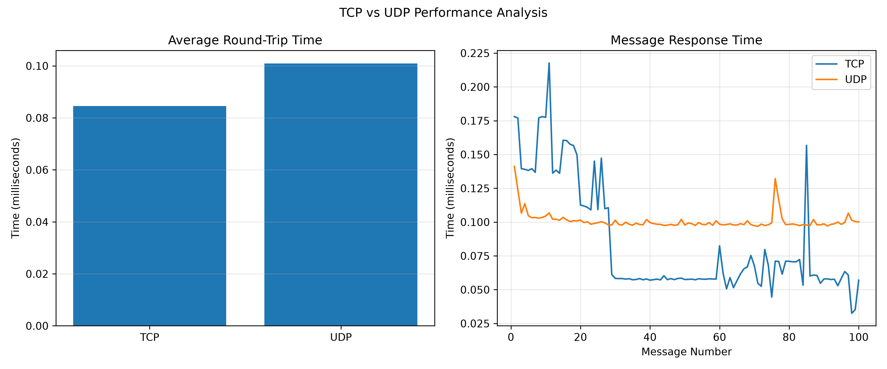

# TCP and UDP Communication System with Performance Comparison

## 1. Project Description

This project demonstrates communication between a client and a server using TCP and UDP protocols through Python Socket Programming.

It also compares the performance of TCP and UDP by measuring their Round Trip Time (RTT) and displaying the results using graphs.

## 2. Features

- TCP client-server communication.
- UDP client-server communication.
- Two-way message exchange.
- Performance comparison between TCP and UDP.
- Measurement of minimum, maximum, and average Round Trip Time.
- Graphical representation of performance results.

## 3. Software Requirements

- Python 3.x
- Visual Studio Code
- Matplotlib library
- Windows operating system

## 4. Project Folder Structure

```text
TCP-UDP-Communication-System/
│
├── TCP_UDP_Project/
│   ├── tcp_server.py
│   ├── tcp_client.py
│   ├── udp_server.py
│   ├── udp_client.py
│   ├── performance_test.py
│   └── tcp_udp_comparison.png
│
└── README.md
```

## 5. Steps to Run the Project

### Step 1: Install Python

Install Python 3.x on your computer.

### Step 2: Install Matplotlib

Open the terminal and execute:

```bash
python -m pip install matplotlib
```

### Step 3: Run TCP Communication

Open two terminals.

Terminal 1:

```bash
cd TCP_UDP_Project
python tcp_server.py
```

Terminal 2:

```bash
cd TCP_UDP_Project
python tcp_client.py
```

### Step 4: Run UDP Communication

Open two terminals.

Terminal 1:

```bash
cd TCP_UDP_Project
python udp_server.py
```

Terminal 2:

```bash
cd TCP_UDP_Project
python udp_client.py
```

### Step 5: Run Performance Comparison

Execute:

```bash
cd TCP_UDP_Project
python performance_test.py
```

The program measures TCP and UDP Round Trip Time and generates comparison graphs.

## 6. Performance Results

The performance test measures:
- Average Round Trip Time
- Minimum Round Trip Time
- Maximum Round Trip Time

The results are displayed using bar and line graphs.



*Note: Results may vary depending on the system and network conditions.*

## 7. Networking Concepts Used

- Computer Networks
- Client-Server Architecture
- Socket Programming
- Transmission Control Protocol (TCP)
- User Datagram Protocol (UDP)
- Round Trip Time (RTT)

## 8. Future Enhancements

- Test communication between different computers.
- Add file transfer functionality.
- Compare performance under different network conditions.
- Create a graphical user interface.

## 9. Conclusion

This project demonstrates the working of TCP and UDP communication using Python socket programming. It also provides a basic performance comparison between the two protocols using Round Trip Time measurements.
